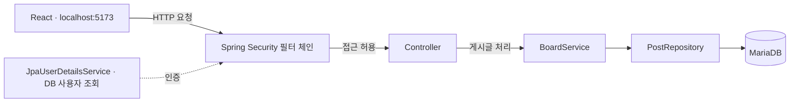

<div align="center">

# Korum

**게시판을 만들며 Kotlin · Spring Boot · React를 배우는 프로젝트**

작은 CRUD에서 시작해 DB 저장, 로그인, 역할별 접근 제어로 확장하고 있습니다.


[학습 진도](#커밋으로-보는-학습-진도) · [현재 기능](#현재-기능) · [로컬 실행](#로컬-실행) · [상세 학습 기록](LEARNING.md)

</div>

> **학습용 프로젝트입니다.** 현재 BCrypt와 DB 사용자로 인증합니다. 고정 실습 계정·프런트 입력값은 로컬 학습용입니다. 회원가입 API를 구현했으며 운영용 입력 정책·계정 관리는 보완 과제입니다.

## 현재 학습 위치 · 2026-11-09

**3일차 메서드 보안·소유자 검사까지 진행:** 로그인 정보를 작성자로 저장하고, `@PreAuthorize`와 `PostGuard`로 본인 또는 관리자만 수정·삭제하도록 구성했습니다. 본인 처리 성공, 관리자 허용, 다른 일반 사용자의 수정·삭제403을 수동 확인했습니다. React 표와 상태 메시지, 새로고침 없는 목록 갱신도 연결했습니다.

다음은 자료 3일차의 **401·403 응답을 JSON으로 통일하기**입니다. 현재 미인증 응답은 상태 코드만 설정하며, 오류 응답 형식과 필터·메서드 거절 로그 구분은 후속 실습입니다.

- [상세 진행 기록](LEARNING.md)
- [집에서 이어하기 — 3일차 남은 실습](docs/2026-11-09-security-day3-resume.md)

## 프로젝트 소개

Korum은 기능을 하나씩 직접 구현하면서 요청이 컨트롤러, 서비스, 저장소를 거쳐 응답으로 돌아오는 과정을 배우는 게시판입니다. 설명과 힌트를 바탕으로 코드를 작성하고, 브라우저와 로그에서 결과를 확인하며 진행합니다.

현재는 **게시글 조회 → 역할별 접근 제어 → BCrypt·DB 로그인 → 회원가입 → 세션 로그인·로그아웃 → 로그인 사용자 글쓰기 → 본인 또는 관리자 수정·삭제**까지 연결했습니다. 다음 목표는 오류 응답 정리와 사용자 입력 UI입니다.

## 커밋으로 보는 학습 진도

```text
메모리 게시판
  → 삭제와 예외 처리
  → 요청·응답 DTO 분리
  → MariaDB / JPA 저장
  → 사용자 엔티티
  → 인증·관리자 권한·React 인증 요청
  → 학습 기록 정리
```

아래 설명은 커밋의 실제 변경 내용을 기준으로 정리했습니다. 초기 이력은 코드 변경 기준이며, 모든 단계의 자동 테스트 통과를 의미하지는 않습니다.

| 날짜 | 커밋 | 진행한 내용 | 이 단계에서 달라진 점 |
|---|---|---|---|
| 2026-10-23 | [`87e575f`](https://github.com/dka5753/Korum/commit/87e575f) | 프로젝트 시작 | Kotlin/Spring 백엔드와 React 프런트 구성. 메모리 저장소로 게시글 조회·작성·수정 API의 출발점 마련 |
| 2026-10-23 | [`5715c30`](https://github.com/dka5753/Korum/commit/5715c30) | 삭제 메서드 구현 | 컨트롤러·서비스·저장소에 삭제 흐름 추가, 프런트 요청 처리 변경 |
| 2026-10-23 | [`145ea29`](https://github.com/dka5753/Korum/commit/145ea29) | 예외 처리 구현 | 게시글이 없을 때의 전용 예외와 전역 처리 추가. 생성 요청 DTO 도입 시작 |
| 2026-10-26 | [`ae66a0d`](https://github.com/dka5753/Korum/commit/ae66a0d) | DTO 매핑과 작성 흐름 정리 | 생성 요청·응답 DTO와 매핑 함수 연결. 저장 모델과 API 입출력을 구분하는 구조로 발전 |
| 2026-10-27 | [`4a41bb8`](https://github.com/dka5753/Korum/commit/4a41bb8) | 저장소 정리 | 추적 중이던 IDE 설정과 JVM 오류 로그 제거. 이 커밋의 주된 변경은 저장소 파일 정리 |
| 2026-10-27 | [`ce247f1`](https://github.com/dka5753/Korum/commit/ce247f1) | MariaDB 실행 환경 구성 | Docker Compose, MariaDB 드라이버, DB 연결 및 환경변수 설정 추가 |
| 2026-10-27 | [`f0ea54f`](https://github.com/dka5753/Korum/commit/f0ea54f) | 게시판 JPA 전환 | 메모리 저장소를 `JpaRepository`로 교체. 엔티티와 수정·삭제 트랜잭션 구성 |
| 2026-10-27 | [`4843e2b`](https://github.com/dka5753/Korum/commit/4843e2b) | 사용자 엔티티 추가 | `users` 테이블에 대응하는 ID·이메일·사용자 이름 모델 추가. 로그인 연결은 아직 별도 과제 |
| 2026-11-03 | [`91c6514`](https://github.com/dka5753/Korum/commit/91c6514) | Spring Security 1일차 | 폼 로그인, 메모리 USER/ADMIN 계정, 공개·인증·관리자 규칙, `/me`, 관리자 API, React Basic 요청과 CORS 구성 |
| 2026-11-03 | [`6565cf1`](https://github.com/dka5753/Korum/commit/6565cf1) | 학습 과정 문서화 | 확인한 결과, 오류 해결, 학습용 설정과 미구현 과제를 [LEARNING.md](LEARNING.md)에 기록 |
| 2026-11-04 | [`4797e1d`](https://github.com/dka5753/Korum/commit/4797e1d) | BCrypt·DB 로그인 전환 | 사용자 저장소·조회 서비스·DB 초기화 작성, 회원가입 DTO와 빈 서비스 뼈대 저장 |
| 2026-11-05 | [`9b5b43b`](https://github.com/dka5753/Korum/commit/9b5b43b) | 회원가입과 CSRF 연결 | 입력400·중복409·성공201 응답, USER 저장, 토큰 API와 쿠키 포함 React 요청 구성 |

### 최근 실습에서 직접 확인한 변화

| 실습 전 | 실습 후 |
|---|---|
| 보안 없는 게시글 API | GET 조회를 공개하고 나머지 요청은 인증 대상으로 설정 |
| 고정 문자열을 반환하는 `/me` | `Principal`에서 현재 로그인 이름을 읽어 JSON으로 응답 |
| 일반 사용자도 열 수 있던 관리자 API | `ADMIN` 역할은 허용하고 일반 사용자는 403으로 거절 |
| React에서 단순 게시글 조회 | 인증 헤더를 담은 `/me` 요청과 응답 확인 |
| CORS 포트 불일치로 요청 실패 | 프런트 Origin을 맞춘 뒤 `posts`, `me`의 200 응답 확인 |

## 현재 기능

### 백엔드 API

| 메서드 | 경로 | 기능 | 접근 조건 |
|---|---|---|---|
| GET | `/posts` | 게시글 목록 | 누구나 |
| GET | `/posts/{id}` | 게시글 상세 | 누구나 |
| POST | `/posts` | 게시글 작성 API | 인증 필요, CSRF 기본 보호 적용 |
| PUT | `/posts/{id}` | 게시글 제목 수정 API | 본인 또는 관리자, CSRF 토큰 필요 |
| DELETE | `/posts/{id}` | 게시글 삭제 API | 본인 또는 관리자, CSRF 토큰 필요 |
| GET | `/me` | 현재 로그인 사용자 이름 | 인증 필요 |
| GET | `/csrf` | CSRF 토큰 조회 | 누구나 |
| POST | `/signup` | 회원가입·USER 계정 저장 | 로그인 불필요, CSRF 토큰 필요 |
| GET | `/admin/check` | 관리자 역할 실습 | `ADMIN` 역할 필요 |
| POST | `/api/login` | 폼 로그인 처리, 성공200·실패401 | 로그인 불필요, CSRF 토큰 필요 |
| POST | `/api/logout` | 세션 무효화, 성공200 | CSRF 토큰 필요 |

React에서 CSRF 토큰을 포함한 작성·수정·삭제 요청을 연결했습니다. 글쓰기 요청은 제목·내용만 받고 작성자는 `Principal.name`으로 정합니다. 수정·삭제는 `PostGuard`의 작성자 비교 또는 `ADMIN` 역할 검사로 허용합니다. `/admin/**`의 URL 규칙은 인증 여부를 확인하고, 현재 `AdminController` 클래스의 `@PreAuthorize`가 관리자 역할을 검사합니다.

### 프런트에서 확인한 기능

- 게시글 목록 조회 및 표시
- CSRF 토큰과 폼 데이터로 로그인 후, 세션 쿠키로 `/me` 호출
- Console에서 `{"username":"user"}` 응답 확인
- 잘못된 비밀번호의 401과 관리자 권한 부족의 403 비교
- CSRF 토큰을 받아 쿠키와 함께 회원가입 POST 전송, 201·400·409 비교
- 로그아웃200 이후 `/me`가 401로 거절되는 흐름 확인
- 로그인 전후 세션 ID 변경 확인

게시글은 표로 표시하며 작성·수정·삭제 성공 후 React 상태를 갱신합니다. 로그인·로그아웃 및 수정·삭제 결과를 화면 메시지로 표시합니다. 가입·로그인·글쓰기·제목 수정은 아직 고정 실습값입니다. 내 정보와 일부 상태는 Console에 출력하며 네트워크 예외 처리, 새로고침 후 사용자 이름 복원, 사용자 입력 UI는 후속 과제입니다.

## 구조



`/me`는 로그인 정보를 읽어 직접 응답합니다. 위 서비스·저장소·DB 흐름은 게시글 처리 기준이며, DB 사용자와 로그인은 `JpaUserDetailsService`로 연결했습니다.

```text
Korum/
├── README.md                    # 소개 · 커밋별 진도 · 실행 안내
├── LEARNING.md                  # 상세 실습 결과와 다음 과제
├── compose.yaml                 # MariaDB 로컬 실행
├── korum/                       # Kotlin / Spring Boot
│   └── src/main/kotlin/com/example/korum/
│       ├── config/              # 접근 규칙 · BCrypt · DB 계정 초기화
│       ├── controller/          # posts · me · admin API
│       ├── dto/                 # 요청·응답과 매핑
│       ├── exception/           # 게시글 예외 처리
│       ├── model/               # Post · User 엔티티
│       ├── repository/          # JPA 저장소
│       └── service/             # 게시글 처리
└── korum-frontend/               # React / TypeScript / Vite
    └── src/App.tsx               # 목록 조회 · 회원가입 · 세션 로그인/조회/로그아웃
```

## 로컬 실행

Java 21, Node.js/npm(Vite 8과 호환되는 버전), Docker Compose가 필요합니다. IntelliJ로 백엔드를 실행할 수도 있습니다.

### 1. DB 환경변수 준비

저장소 루트에 `.env`를 만들고 로컬에서 사용할 값을 넣습니다. 아래 값은 직접 정할 자리표시자입니다.

```dotenv
DB_ROOT_PASSWORD=여기에_로컬_DB_루트_비밀번호
DB_PASSWORD=여기에_로컬_애플리케이션_DB_비밀번호
```

`.env`는 Git에서 제외됩니다. Compose는 루트의 `.env`를 사용하지만 **백엔드의 일반 터미널 실행에 같은 값이 자동 전달되는 것은 아닙니다.**

기존 DB 볼륨이 있다면 `.env`를 바꾸는 것만으로 DB 계정 비밀번호가 바뀌지는 않습니다. 기존 계정에 맞는 값을 사용합니다.

### 2. MariaDB 실행

저장소 루트에서:

```bash
docker compose up -d mariadb
docker compose ps
```

연결 정보는 `localhost:3307/korum`이며, 컨테이너 내부의 3306 포트에 연결됩니다.

### 3. 백엔드 실행

Windows IntelliJ에서는 `KorumApplication.kt`의 `fun main` 옆 실행 버튼으로 구성을 만들고, 구성 편집의 환경 변수에 `.env`와 같은 `DB_PASSWORD`를 넣습니다. 실행 진입점은 `com.example.korum.KorumApplicationKt`, Java toolchain은 21입니다. `.env`가 IntelliJ 실행에 자동 전달된다고 가정하지 않습니다.

DB·백엔드·프런트는 함께 실행되어야 합니다. `ERR_CONNECTION_REFUSED`는 백엔드 실행 상태와 8080 포트를 먼저 확인하고, `Access denied`는 DB 비밀번호와 실행 환경 변수를 확인합니다. 기존 DB 볼륨은 문제 확인 없이 삭제하지 않습니다.

실행할 터미널 또는 IntelliJ 실행 설정에 `.env`와 같은 `DB_PASSWORD`를 전달합니다. macOS zsh에서는 입력값을 화면에 표시하지 않고 다음처럼 설정할 수 있습니다.

```zsh
read -s "DB_PASSWORD?DB 비밀번호 입력: "
export DB_PASSWORD
```

그다음 저장소 루트에서:

```bash
cd korum
./gradlew bootRun
```

`Started KorumApplication...`이 표시되면 백엔드가 준비된 상태입니다. IntelliJ와 터미널에서 동시에 실행하면 8080 포트가 충돌할 수 있습니다.

### 4. 프런트 실행

새 터미널에서 저장소 루트 기준:

```bash
cd korum-frontend
npm ci
npm run dev
```

출력된 `Local` 주소를 엽니다. 현재 CORS 설정은 `http://localhost:5173` 기준입니다. Vite가 다른 포트로 실행되면 백엔드의 허용 Origin도 일치시켜야 합니다.

### 5. 동작 비교

| 확인할 것 | 방법 | 예상 결과 |
|---|---|---|
| 공개 조회 | 로그인 없이 `/posts` 접속 | 게시글 JSON 배열 |
| 로그인 사용자 | React 로그인 버튼 후 내 정보 버튼 | `{"username":"user"}` 등 현재 계정 이름 |
| 일반 계정의 관리자 접근 | `user`로 `/admin/check` 접속 | 403 |
| 관리자 접근 | `admin`으로 `/admin/check` 접속 | `관리자 기능` |
| 프런트 인증 요청 | React의 내 정보 버튼 클릭 | Console에 사용자 JSON, Network 200 |
| 로그아웃 | React 로그아웃 버튼 후 내 정보 버튼 | 로그아웃200, 조회401 |

현재 로컬 실습 계정 `user`, `admin`의 비밀번호는 모두 `1234`입니다. 폼 로그인 세션의 영향을 피해서 계정을 비교하려면 기존 시크릿 창을 모두 닫고 새 시크릿 창에서 시작합니다.

## 학습용 설정과 검증 범위

- 1일차의 메모리 계정·`{noop}`에서 BCrypt와 DB 로그인으로 전환했습니다. 초기화기의 고정 계정은 학습용입니다.
- Basic 인증은 비활성화했습니다. React는 세션 쿠키를 사용하고, 인증되지 않은 보호 API 요청은 로그인 화면 대신 401을 반환합니다. 폼 로그인에 사용하는 고정 계정은 로컬 실습용입니다.
- TRACE 로깅은 필터 순서를 관찰하려고 켰습니다. 실습 후 필요한 로그 수준으로 조정합니다.
- 수동으로 브라우저, Console, Network와 서버 로그를 확인했습니다. 자동 테스트 통과를 검증한 상태는 아닙니다.
- OPTIONS 사전 요청과 응답의 CORS 허용 헤더 자체는 아직 직접 관찰하지 않았습니다.

구현 파일별 설명과 해결한 오류는 **[상세 학습 기록](LEARNING.md)**에 정리했습니다.

## 다음 목표

- [x] 게시글 API와 DTO·예외 처리
- [x] MariaDB와 JPA 저장 구조
- [x] 로그인 사용자 정보 조회
- [x] 일반 사용자·관리자의 접근 차이 확인
- [x] React 인증 요청과 CORS 연결
- [x] BCrypt 비밀번호 검증
- [x] DB 사용자 로그인
- [x] 로그인 사용자만 글을 작성하는 실습 버튼·요청·CSRF 처리 연결
- [x] 로그인한 사용자를 작성자로 자동 저장
- [x] 본인 또는 관리자만 수정·삭제할 수 있도록 검사
- [x] 회원가입 API·입력/중복 검사·CSRF 토큰 요청
- [x] React 세션 로그인·로그아웃
- [ ] 사용자용 로그인·오류 UI와 접근 제어 테스트

**다음에 만들고 싶은 모습:** 누구나 글을 읽고, 로그인한 사람은 자기 이름으로 글을 쓰고, 자기 글만 수정·삭제할 수 있는 게시판.

---

새 기능을 구현하면 관련 커밋과 확인한 동작을 진도표에 추가하고, 자세한 과정은 [LEARNING.md](LEARNING.md)에 이어 기록합니다.
